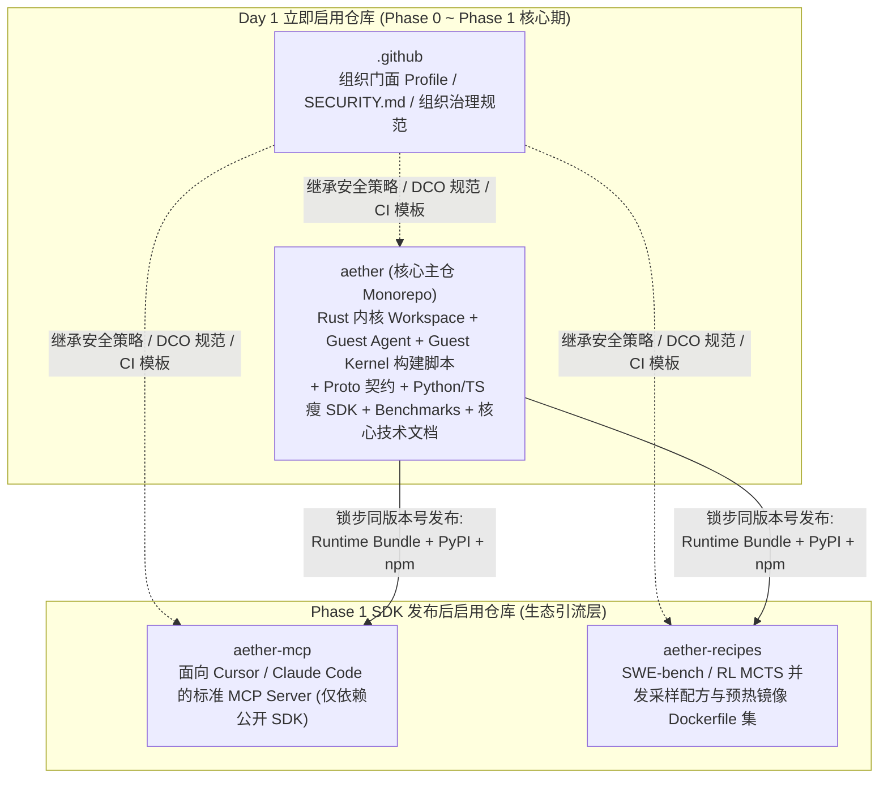

# GitHub Organization 全局仓库拓扑、文档体系与工程治理规划

> **已锁定 GitHub 组织**：[`https://github.com/aether-vm`](https://github.com/aether-vm)  
> **组织定位**：承载 `Aether` 有状态安全沙箱与整机运行态分叉引擎（Stateful Sandbox & VM Forking Runtime）全生态的开源与商业化主阵地。  
> **生态命名映射（已实测可用）**：GitHub Org `aether-vm` ｜ 核心主仓 `aether-vm/aether` ｜ PyPI 包名 `aether-vm` ｜ npm 包名 `@aether-vm/sdk` ｜ 内部 Rust Crates `aos-*` / `agentd`。

---

## 一、组织拆分核心准则：「强耦合同仓原子演进，弱耦合按阶段拆仓」

针对 1~2 名核心架构师 + AI 研发特战队的真实产能，借鉴 `firecracker-microvm`、`astral-sh (uv/ruff)` 与 `containerd` 的实战教训，确立两条硬性仓库治理原则：

1. **严禁跨仓契约同步摩擦**：凡共享内部状态机、二进制协议（`proto/`）或必须在同一 KVM CI 中联合验证的模块（`agentd`、`aos-guest`、双语瘦 SDK、基准压测），在 `v1.0` 协议冻结前 **100% 收敛在核心主仓 `aether` 内**，单次 PR 原子提交。
2. **未达阶段条件不建空壳仓库（O4 准则）**：Day 1（Phase 0 ~ Phase 1 核心研发期）仅建立并维护 **`.github`**（组织门面与安全披露策略）与 **`aether`**（核心主仓）两个仓库；外围生态卫星仓在 Phase 1 正式发布可用 SDK 后按需激活。

---

## 二、GitHub Organization 仓库分期矩阵

### 各仓库职责、交付物与开源治理边界

| GitHub 仓库 | 启用时机 | 核心职责与包含模块 | 许可证与贡献协议 | 版本与真实交付物说明 |
| :--- | :--- | :--- | :--- | :--- |
| **`.github`** | **Day 1** | • `profile/README.md`（组织首页总览） • `SECURITY.md`（内核/虚拟化逃逸漏洞私密披露流程） • `brand/`（组织视觉识别系统与 Design Tokens 权威源：`svg/` 矢量 Logo、`png/` 图标与 favicon、`tokens/` CSS Variables + Tailwind Preset、商标使用说明） • Issue/PR 模板与组织级规范 | Apache-2.0 | 本地模板存放于 `repos/dot-github/`，推送远端时关联至 `aether-vm/.github`。 |
| **`aether`** | **Day 1** | • `crates/`：`agentd`、`aos-types`、`aos-store`、`aos-meta`、`aos-sandbox`、`aos-gw`、`aos-guest`、`aos-cli` • `guest-image/`：Guest Linux 内核裁剪配置、Inspector `initramfs` 构建及 **GPLv2 内核源码合规脚本** • `proto/`：gRPC 唯一事实源（含版本协商 RPC 与 `buf breaking` 检查） • `sdk/python/` & `sdk/typescript/`：gRPC 瘦客户端 • `benchmarks/`：Phase 0 证伪与回归基准套件 • `docs/` & `AGENTS.md`：架构规范、定位白皮书、证伪手册与工程红线 | **Apache-2.0** + **DCO / CLA**（接收首个外部 PR 前强制启用，保障未来 Open-Core 演进权利） | `v1.0` 前全组件**锁步同版本号**。完整发行包（**Runtime Release Bundle**）除 `agentd`/`aos-gw`/`aos` 主程序外，明确包含静态 `aos-guest`、定制 `vmlinux` 与 `initramfs`，并注明宿主机外部依赖（`firecracker`/`jailer`、`btrfs-progs`、`e2fsprogs`）。 |
| **`aether-mcp`** | **Phase 1 发布后** | • 轻量 MCP Server（暴露本地 tar 流导入、分叉、存档、回滚、补丁导出） | **MIT** | 仅消费公开发布的 SDK 与版本协商接口；当前最多在 GitHub 建私有空仓占名，不在本地维护空壳代码。 |
| **`aether-recipes`** | **Phase 1 发布后** | • SWE-bench / RL 采样脚本、PostgreSQL 预热模板与对比基准复现配方 | **MIT** | 面向 Python AI 算法与测试团队零门槛引流。 |

---

## 三、Windows + WSL2 单一工作副本工作流（消除双端分裂 O1~O3）

针对当前开发机实况（**Surface Pro 8, i5-1135G7, 16GB RAM, Windows C 盘物理剩余 ~56GB + WSL2 Ubuntu 22.04 内核 6.6.87**），严格执行以下物理约束：

1. **严禁双工作副本并存（Single Working Copy）**：
   - 当前 Windows 侧 `C:\work\project\ai-game\repos\` 仅作为初始化定稿交付区；正式启动 Phase 0 编码时，直接将 `repos/aether` 与 `repos/dot-github` 迁入 WSL2 原生 `ext4` 文件系统 `~/work/aether-vm/` 下执行 `git init` 并推送远端，日常统一通过 **Cursor WSL Remote** 直接打开 `~/work/aether-vm/aether` 开发（避免 NTFS 上的 CRLF 换行污染、可执行位丢失与符号链接损坏）。
   - 仓库内强制配备 `.gitattributes`（`* text=auto eol=lf`）。
   - 核心工程宪章 `AGENTS.md` 直接内置于 `repos/aether/AGENTS.md`，确保 WSL Remote 打开单仓时 AI 特战队红线 100% 自动生效。
2. **WSL2 物理磁盘封顶与性能边界**：
   - WSL2 `df -h` 显示的 `950G` 仅为动态 `.vhdx` 虚拟上限，**真实物理上限受制于宿主机 C 盘剩余空间（~56GB）**。WSL2 内挂载的实验 Btrfs 存储池大小**硬性封顶在 `12 GiB ~ 16 GiB`**，防止写满宿主机磁盘导致底层 I/O 损坏。
   - 本机 16GB 物理内存（建议 `.wslconfig` 调至 `8GB`）仅用于验证功能正确性与小规格分叉；高密度并发克隆（如 `2GiB × 16`）基准必须在独立裸金属 Linux 主机上采集，严禁把笔电 L2 嵌套虚拟化延迟当作正式指标对外发布。
3. **安全的跨边界调用**：
   - `agentd` 接口等价于 root 权限，**默认仅监听权限受限的 Linux Unix Domain Socket，绝不默认开启本地 TCP 端口**。当 Windows 侧 Cursor 调用 WSL2 内的工具或 MCP 时，统一通过 `wsl.exe -d Ubuntu-22.04 -- ...` 标准输入输出（`stdio`）管道桥接。

---

## 四、全组织文档唯一权威路径台账（Single Source of Truth）

| 文档职责 | 唯一权威路径 | 当前状态 |
| :--- | :--- | :--- |
| **工作区总导航与 AI 特战队宪章** | `./AGENTS.md`（并同步内置于 `./repos/aether/AGENTS.md`） | 已生效 |
| **GitHub 组织拓扑与治理规划书** | `./ORGANIZATION_PLAN.md`（本文件） | 已生效（v2.1 终审版） |
| **组织对外主页与安全披露规范模板** | `./repos/dot-github/profile/README.md` & `./repos/dot-github/SECURITY.md` | 已就绪（推送至 `aether-vm/.github`） |
| **组织视觉识别系统（VI）与 Design Tokens 权威源** | `./repos/dot-github/brand/`（说明：`brand/README.md`；远端 `aether-vm/.github/brand`） | 已生效（Logo / Icon / CSS Variables / Tailwind Preset） |
| **产品定位、核心能力与行业应用白皮书** | `./repos/aether/docs/PRODUCT_POSITIONING.md` | 已生效 |
| **核心运行时架构规范（含提交状态机与威胁模型）** | `./repos/aether/docs/ARCHITECTURE_V2.md` | 已生效（合入 Gate 1 A1~A7 修订） |
| **Phase 0 内核原语证伪实验手册（唯一指标源）** | `./repos/aether/docs/PHASE0_FALSIFICATION.md` | 已生效 |
| *历史归档（已被 V2 取代，严禁作为实现依据）* | *已移除重复旧稿，变更记录见 `ARCHITECTURE_V2.md` 第 0 节* | — |
